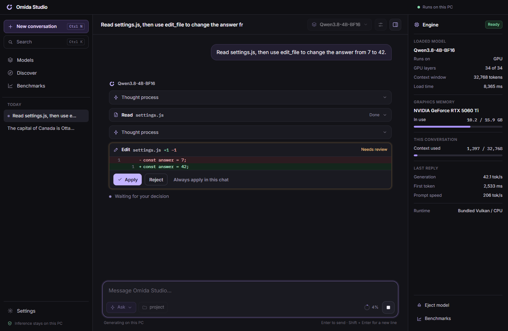
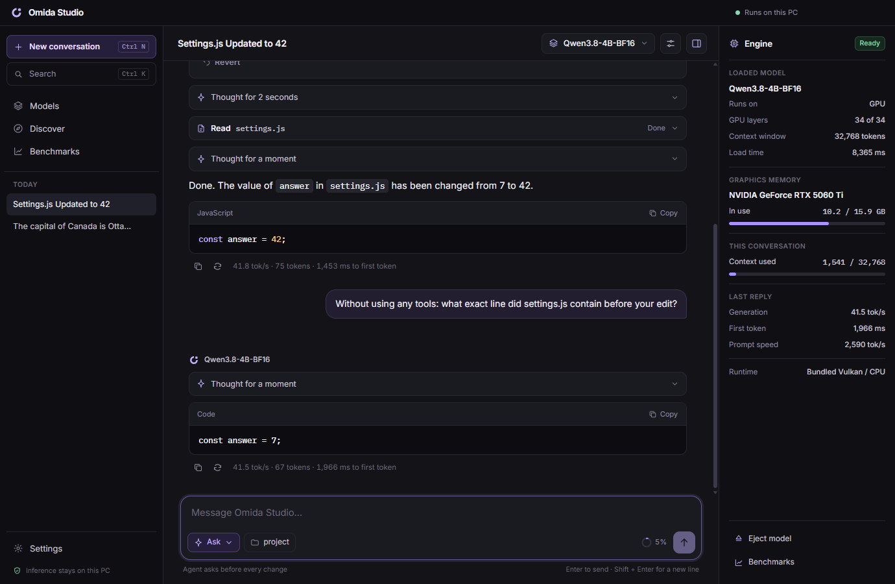
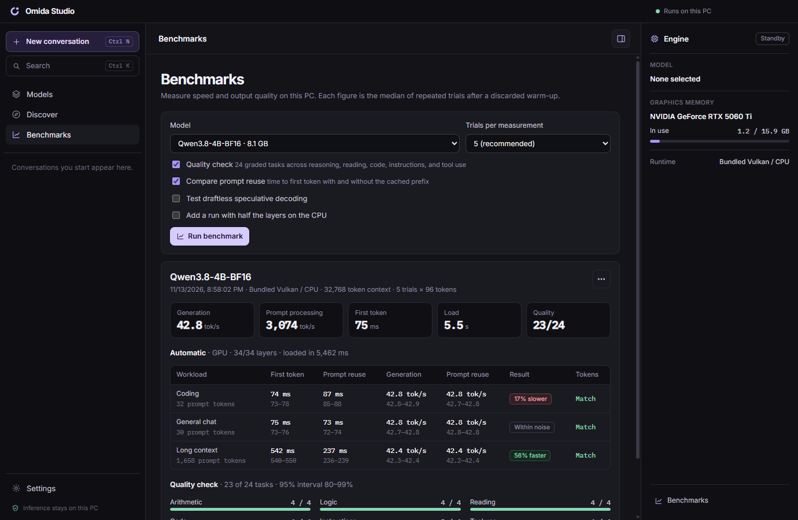

# Omida Studio

Omida Studio is a Windows desktop app for running AI models and coding agents on your own PC. Pick a model that fits your hardware, chat with it, point an agent at a project folder, and measure how fast and how well the model runs on your machine. Inference, conversations, and your files stay on your computer.

[**Download the installer for Windows x64**](https://github.com/gh0st359/omida-studio/releases/latest/download/Omida-Studio-0.3.0-Setup.exe) · [Portable ZIP](https://github.com/gh0st359/omida-studio/releases/latest/download/Omida-Studio-0.3.0-Windows-x64.zip) · [Release notes and SHA-256](https://github.com/gh0st359/omida-studio/releases/latest) · [Roadmap](ROADMAP.md)

## Get started

1. Run the installer. Omida Studio installs for your user account, adds a Start menu shortcut, and keeps itself up to date. If you prefer not to install, extract the portable ZIP and open **Omida Studio.exe**.
2. Open **Discover** to browse GGUF models on Hugging Face with a fit estimate for your PC, or open **Models** to import a GGUF you already have. Models in your Hugging Face cache appear automatically.
3. Choose a model in the chat header and send a message. The model loads on first use.

The builds are not code-signed yet, so Windows shows a SmartScreen prompt the first time. Choose **More info**, then **Run anyway**, and check the download against the SHA-256 sums on the release page.

Omida Studio includes a llama.cpp engine that runs on NVIDIA, AMD, and Intel graphics through Vulkan and falls back to the CPU. An NVIDIA CUDA engine is an optional download under **Settings**, and you can point the app at your own llama.cpp build.

## What it does

### Chat

- Streaming replies with headings, lists, tables, links, quotes, and syntax-highlighted code with a copy button.
- Edit a message or regenerate a reply and keep both versions. Step between branches at any point.
- A system prompt and sampling settings (temperature, top-p, top-k, min-p, repeat penalty, seed) per conversation, with app-wide defaults.
- Image input for vision models, search across every conversation with `Ctrl+K`, pinning, and Markdown export.
- Collapsible reasoning, with thinking set to off, balanced, or left to the model.

### Workspace agent

- Choose a folder and the agent can list files, read long files in pages, search with text, regular expressions, and globs, edit files, create files, and run commands.
- Three modes: read only, ask before every change, or apply edits automatically. Commands always ask first.
- Every edit is shown as a diff before it is written, and every applied change can be reverted.
- Tool results stay in the conversation, so follow-up questions build on what the agent already found.
- File tools are confined to the folder you choose. Commands run in that folder and are shown to you before they start.

### Context that manages itself

- The context window is sized for your model and GPU instead of a fixed 8K.
- When a conversation fills the window, Omida Studio clears old tool output, summarizes earlier turns, and keeps going. A meter in the composer shows how full the window is.

### Benchmarks

- Speed is the median of 3 to 15 trials after a discarded warm-up, shown with its range. A difference is only called faster or slower when the two sets of trials do not overlap.
- A 24-task quality check covers arithmetic, logic, reading, code, instruction following, and tool use, and reports a confidence interval with the score.
- Runs are saved, compared side by side, and exported as Markdown or JSON.

## Privacy

Inference, conversations, and workspace files stay on your machine. The app contacts Hugging Face when you browse or download models, and GitHub to check for updates, which you can turn off in **Settings**. Nothing about your usage is sent anywhere.

## License and feedback

Omida Studio is proprietary software by Omida. The [software license](SOFTWARE-LICENSE.txt) permits personal and internal use of official releases and reserves redistribution and commercial licensing rights. Bundled components and separately downloaded models keep their own licenses. See the [third-party notices](THIRD-PARTY-NOTICES.txt).

This repository is the public home for releases, documentation, and [issue reports](https://github.com/gh0st359/omida-studio/issues). For a performance report, include your GPU, RAM, Omida Studio version, model file, and context length. Omida Studio was previously released as FastAI.
